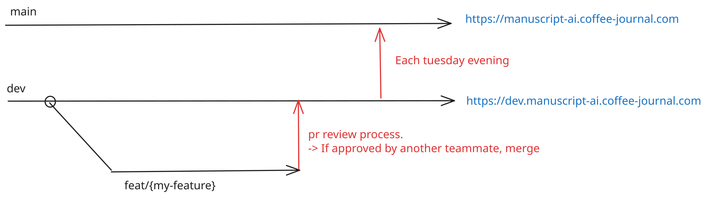
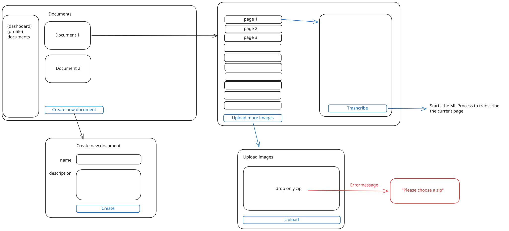

# Workflow

## Branching strategy

- We work on feature branches that we merge to dev
- Feature branches follow this convention feat/{some-good-name}
- Fix branches follow this convention: fix/{some-good-name}
- Each tuesday evening, we deploy dev to main

**Commits**
Commit messages follow this structure:

`<type>(<optional scope>): <description>`

with types:

- build: anything that drives features forward
- docs: everything docs related
- test: everything test related
- chore: small, cleanup tasks
- refactor: refactorin changes.

and scopes when matching:

- ml
- webapp
- ci

## MVP (Finished 28.10.2026)

The mockup of the mvp is as follows. The MVP has been an intermediate state on 28.10.2026.

